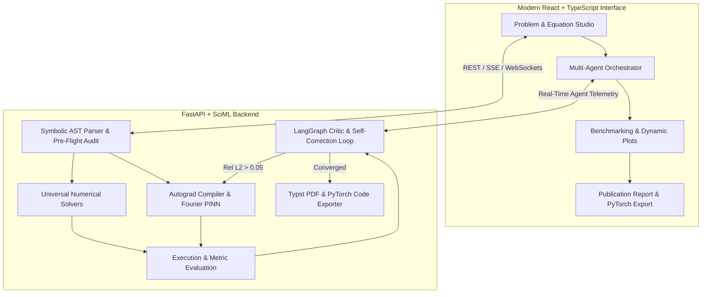

# SciAgent: Autonomous Scientific Machine Learning & PINN Discovery Platform

[](https://opensource.org/licenses/MIT)
[](https://www.python.org/)
[](https://pytorch.org/)
[](https://react.dev/)
[](https://fastapi.tiangolo.com/)

**SciAgent** is an end-to-end, autonomous Scientific Machine Learning (SciML) platform that bridges the gap between symbolic mathematical modeling, numerical reference solvers, and self-correcting Physics-Informed Neural Networks (PINNs). 

From arbitrary LaTeX or SymPy equations, SciAgent parses the governing physics, classifies the mathematical regime, solves the exact ground truth using high-order numerical methods, trains multi-scale Fourier-feature PINNs with causal temporal curriculum and Residual-based Adaptive Refinement (RAR), audits physical conservation laws, and compiles publication-grade academic PDF manuscripts (via Typst) alongside reproducible PyTorch scripts.

---

## 🌟 Key Capabilities

### 1. Symbolic Physics AST & Automated Invariant Discovery
- **Arbitrary LaTeX & SymPy Ingestion:** Automatically parses nonlinear PDEs and ODEs from raw LaTeX strings (e.g. `\frac{\partial u}{\partial t} + u \frac{\partial u}{\partial x} = \nu \frac{\partial^2 u}{\partial x^2}`).
- **Multi-Dimensional Support:** Seamlessly handles **ODEs** ($t$), **1D PDEs** ($x, t$), **2D PDEs** ($x, y, t$), and **3D PDEs** ($x, y, z, t$).
- **Complex-Valued PDE Support:** Automatically maps complex equations ($i\psi_t + \psi_{xx} + |\psi|^2\psi = 0$) into coupled real and imaginary systems ($u, v$).
- **Pre-Flight Stability & Conservation Audit:** Symbolically detects whether an equation preserves **Mass** ($\int u \, dx$), **$L^2$ Energy Norm** ($\int |u|^2 \, dx$), or **Hamiltonian Energy**, alerting researchers to high-Péclet regimes or dispersive stiffness before execution.

### 2. Universal Vectorized Numerical Reference Solvers
SciAgent automatically selects and executes verified reference solutions:
- **Hyperbolic & Parabolic PDEs (1D/2D/3D):** Vectorized Method-of-Lines (MOL) with Crank-Nicolson, Upwind schemes, and adaptive Runge-Kutta (RK45/DOP853).
- **Dispersive & Soliton Systems (KdV, mKdV):** High-order pseudospectral FFT / RK4 solvers for 3rd-order spatial derivatives.
- **Complex Wave Systems (CQ-NLSE, GPE):** Split-Step Fourier Method (SSFM) evaluating amplitude $|\psi|$ and phase dynamics.
- **Nonlinear ODEs (Duffing, Van der Pol):** Scipy `solve_ivp` with DOP853 8th-order explicit Runge-Kutta.

### 3. Self-Correcting PINN Engine & Physics-Informed Curriculum
- **Multi-Scale Fourier Feature Embeddings:** Overcomes spectral bias and gradient pathologies by projecting coordinate inputs into learnable Fourier bands with smooth Tanh activations.
- **Two-Stage Curriculum Training:**
  - *Stage 1 (IC Warmup):* Locks initial condition topology before residual activation.
  - *Stage 2 (PDE Residual & Boundary Enforcement):* Joint optimization with causal temporal weighting and boundary constraints.
- **Residual-based Adaptive Refinement (RAR):** Actively samples collocation points in steep gradient and shock regions across all spatial dimensions ($x, y, z, t$).
- **Hybrid AdamW + L-BFGS Optimization:** High-momentum exploration followed by second-order curvature convergence.
- **Ensemble Uncertainty Quantification (UQ):** Measures predictive standard deviation $\sigma(x, t)$ across model ensembles.

### 4. Closed-Loop Multi-Agent Orchestration (LangGraph + Ollama / Offline Fallback)
SciAgent operates as a 5-node autonomous multi-agent pipeline:
1. **Problem Analysis Agent:** Dissects problem well-posedness, physical dimensions, and invariants.
2. **Method Selection Agent:** Selects the optimal reference solver and PINN hyperparameter architecture.
3. **Execution Engine:** Dispatches high-performance numerical and PyTorch training routines.
4. **Critic & Optimization Agent:** Evaluates solution convergence ($\text{Rel } L^2 < 0.05$). If residual errors or conservation drift exceed thresholds, it triggers self-correcting retraining loops with refined weights.
5. **Research Report Agent:** Synthesizes publication-ready academic manuscripts with rigorous scientific analysis.

### 5. Reproducibility & Publication Artifacts
- **One-Click Standalone PyTorch Export:** Exports self-contained, executable `.py` scripts containing model architectures, autograd compiler, and training loops for 1-command reproduction anywhere (`python sciagent_<id>.py`).
- **Academic PDF Manuscripts:** Compiles 6-section academic papers via Typst, embedding publication plots, relative error convergence curves, parameter discovery tables, and conservation drift metrics.
- **Session Snapshots:** Export and load full experiment state snapshots (`.sciagent` bundle).

---

## 🏛️ System Architecture



---

## 🚀 Quickstart Guide

### Prerequisites
- **Python:** 3.10 or higher
- **Node.js:** 18 or higher (with npm)
- **Git**

*(Optional for local LLM prose generation)*: [Ollama](https://ollama.ai/) with `qwen2.5:latest` (SciAgent includes built-in deterministic physics fallback when Ollama is offline).

---

### Installation

1. **Clone the repository:**
   ```bash
   git clone https://github.com/Devadn11206/Devas-Intelligence.git
   cd Devas-Intelligence
   ```

2. **Backend Setup:**
   ```bash
   # Create and activate virtual environment (optional but recommended)
   python -m venv .venv
   # Windows:
   .venv\Scripts\activate
   # Linux/macOS:
   source .venv/bin/activate

   # Install Python dependencies
   pip install fastapi uvicorn torch sympy numpy scipy matplotlib pydantic langgraph httpx
   ```

3. **Frontend Setup:**
   ```bash
   cd frontend
   npm install
   cd ..
   ```

---

### Running the Application

You can launch both services simultaneously or in separate terminal windows:

#### Terminal 1: Backend API (Port 8080)
```bash
python -m uvicorn backend.app.main:app --host 0.0.0.0 --port 8080 --reload
```

#### Terminal 2: Frontend Dashboard (Port 8001)
```bash
cd frontend
npm run dev -- --port 8001 --host
```

Open your browser and navigate to:
```
http://localhost:8001
```

---

## 🧪 Built-in Presets & Benchmarks

SciAgent comes pre-configured with canonical physics benchmarks across multiple regimes:

| Regime | Equation | Dimension | Baseline Solver | Key Physics |
| :--- | :--- | :--- | :--- | :--- |
| **Viscous Burgers'** | $\partial_t u + u \partial_x u = \nu \partial_{xx} u$ | 1D PDE | Upwind / Crank-Nicolson | Shock formation, boundary layer dissipation |
| **Allen-Cahn** | $\partial_t u = \epsilon^2 \partial_{xx} u + u(1 - u^2)$ | 1D PDE | Crank-Nicolson MOL | Phase separation, metastable interface transitions |
| **Cubic-Quintic NLSE** | $i \partial_t \psi + \frac{1}{2} \partial_{xx} \psi + |\psi|^2 \psi - \gamma |\psi|^4 \psi = 0$ | 1D Complex PDE | Split-Step Fourier (SSFM) | Optical solitons, balance of dispersion and nonlinearities |
| **Forced Duffing** | $\ddot{x} + \delta \dot{x} + \alpha x + \beta x^3 = \gamma \cos(\omega t)$ | ODE (0D Spatial) | Scipy DOP853 | Nonlinear resonance, chaotic limit cycles |
| **Korteweg-de Vries (KdV)** | $\partial_t u + u \partial_x u + \mu \partial_{xxx} u = 0$ | 1D Dispersive PDE | Pseudospectral FFT / RK4 | Solitary wave balance, 3rd-order autograd conditioning |
| **Gray-Scott System** | $\partial_t u = \nu \nabla^2 u + u(1 - u^2)$ | 2D PDE ($x, y, t$) | 2D Vectorized MOL | Reaction-diffusion Turing pattern morphogenesis |
| **3D Nonlinear Diffusion** | $\partial_t u = \alpha \nabla^2 u - \beta u^3$ | 3D PDE ($x, y, z, t$) | 3D Vectorized MOL | Volumetric thermal dissipation with cubic damping |

---

## 📁 Repository Structure

```
nexusai/
├── backend/
│   ├── app/
│   │   ├── agents/               # LangGraph multi-agent loop, critic, & telemetry
│   │   │   ├── graph.py          # 5-node agent pipeline definition
│   │   │   └── llm_client.py     # Local Ollama + deterministic physics fallback
│   │   ├── core/
│   │   │   ├── problem_schema.py # ProblemIR and SolverPlan schemas
│   │   │   └── symbolic_parser.py# SymPy AST parser & conservation discovery
│   │   ├── reports/
│   │   │   ├── code_exporter.py  # Standalone PyTorch script synthesizer
│   │   │   ├── pub_plots.py      # High-DPI publication figure generation
│   │   │   └── typst_builder.py  # Typst academic PDF compiler
│   │   ├── sciml/
│   │   │   ├── autograd_compiler.py # PyTorch PDE residual autograd compiler
│   │   │   ├── models.py         # Multi-scale Fourier Feature PINNs
│   │   │   └── trainer.py        # Two-stage IC warmup, Causal, RAR, L-BFGS loop
│   │   ├── solvers/
│   │   │   └── universal_solver.py # Vectorized 0D/1D/2D/3D numerical baselines
│   │   └── main.py               # FastAPI entrypoint, routes, & CORS handlers
│   └── tests/                    # Integration and regime test suites
├── frontend/
│   ├── src/
│   │   ├── components/           # Navigation, Equation rendering, UI primitives
│   │   ├── data/                 # Preset equations, schemas, and state managers
│   │   ├── services/             # Axios API client & SSE streaming service
│   │   └── views/
│   │       ├── StudioView.tsx        # Equation editor & pre-flight checker
│   │       ├── OrchestratorView.tsx  # Live multi-agent orchestration board
│   │       ├── BenchmarkView.tsx     # Solution comparison & error plots
│   │       └── ReportView.tsx        # Academic PDF viewer & markdown reader
├── .gitignore
└── README.md
```

---

## 🛠️ Verification & Testing

To run the automated physics benchmark suite across all regimes:
```bash
python backend/tests/test_all_five_regimes.py
```

To verify the frontend build:
```bash
cd frontend
npm run build
```

---

## 📜 License

This project is licensed under the MIT License - see the LICENSE file for details.
